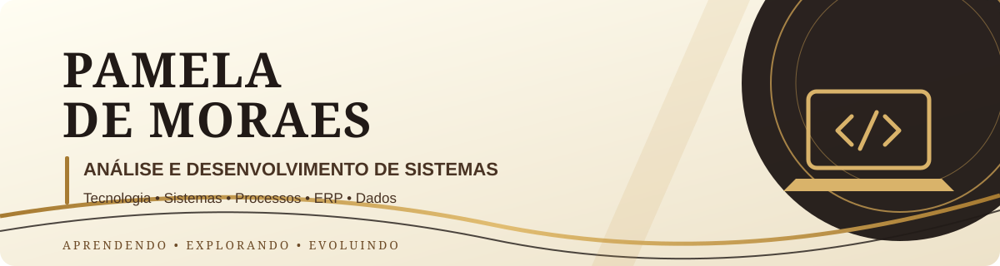

---

## Sobre mim

Sou estudante de Análise e Desenvolvimento de Sistemas na UNICID e estou construindo minha trajetória na área de tecnologia.

Trago uma experiência profissional anterior nas áreas fiscal, contábil e administrativa, que despertou meu interesse por sistemas, processos e soluções tecnológicas.

Atualmente, estou ampliando meus conhecimentos e explorando as possibilidades da tecnologia, conectando minha experiência profissional ao aprendizado adquirido na graduação.

## Tecnologias e conhecimentos

<h2 align="center">✦ TECNOLOGIAS E CONHECIMENTOS ✦</h2>

  
  
  
  

  <b>EM APRENDIZADO</b>

  Lógica de programação · Desenvolvimento Web · Modelagem de Dados

## Minha jornada

Este GitHub é um espaço para registrar meu aprendizado, compartilhar projetos acadêmicos e acompanhar minha evolução na tecnologia.

Cada novo conhecimento representa mais um passo nessa construção profissional.

---

**PAMELA DE MORAES**

*Aprendendo, explorando e construindo novas possibilidades.*

